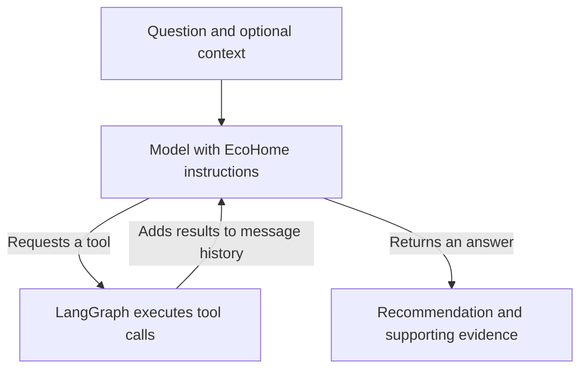

# EcoHome Energy Advisor

**Udacity Nanodegree** · [Agentic AI Engineer with LangChain and LangGraph](https://www.udacity.com/course/agentic-ai-engineer-with-langchain-and-langgraph--nd901)

**Course 2 of 3** · [Building AI Agents with LangGraph](https://www.udacity.com/course/building-ai-agents-with-langgraph--cd14640)

EcoHome Energy Advisor is a LangGraph agent that helps a household decide when to charge an EV, run appliances, or use rooftop solar. It combines household history from SQLite, simulated weather and electricity rates, and energy-saving guides retrieved from Chroma. Recommendations can include cost, payback, and avoided-emissions estimates.

Open the [evaluation notebook](03_run_and_evaluate.ipynb) to inspect the saved responses, tool calls, and score report. The [quick start](#quick-start) reproduces the full workflow with a course-provided Vocareum credential.

## Example questions

| Task | Example |
| --- | --- |
| EV scheduling | When should I charge my EV tomorrow to use solar and reduce grid costs? |
| Tariff comparison | How much do I save by moving a 1.2 kWh dishwasher cycle from 19:00 to 22:00? |
| Battery and guide retrieval | How long can 4 kWh above my battery's reserve supply a steady 1 kW load? Cite the battery guide. |
| Return on investment | What are the payback and two-year ROI for a USD 100 upgrade that saves 2 kWh per day at USD 0.20/kWh? |

In the saved dishwasher scenario, the agent multiplies 1.2 kWh by the difference between USD 0.28/kWh and USD 0.12/kWh, for a saving of USD 0.192 per cycle.

## Quick start

### 1. Clone and install

Use Git and Python 3.11. The project was tested with Python 3.11.18. Run the commands and notebooks from the repository root so their relative data paths resolve correctly.

```bash
git clone https://github.com/robertishimurasousa/Udacity-Energy-Advisor.git
cd Udacity-Energy-Advisor
python3.11 -m venv .venv
source .venv/bin/activate
python -m pip install -r requirements.txt
cp -n .env.example .env
```

On Windows PowerShell, activate the environment with `.venv\Scripts\Activate.ps1` and copy `.env.example` to `.env` if the file does not exist.

### 2. Configure Vocareum

Set `VOCAREUM_API_KEY` in `.env` using the credential supplied in the Udacity workspace. Notebook 02 uses the credential for embeddings, and notebook 03 uses it for model calls. The database setup and local unit tests can run without a credential.

### 3. Run the notebooks

Open the notebooks in a Jupyter editor, select the `.venv` Python kernel, and run them in order.

| Notebook | What you should see |
| --- | --- |
| [01 · Database setup](01_db_setup.ipynb) | SQLite creates the usage and solar tables and seeds 2,160 usage rows and 390 solar rows. The final cells inspect the data through Python and through the agent's database tools. |
| [02 · RAG setup](02_rag_setup.ipynb) | Seven guides become 14 indexed chunks. Five queries verify that the corresponding new guide can be retrieved with its source path. |
| [03 · Agent and evaluation](03_run_and_evaluate.ipynb) | An EV example shows the agent loop. Eleven scenarios record the executed tools, arguments, results, and final answers. The final report scores this run and lists unmet checks. |

The first run builds `data/energy_data.db` and `data/vectorstore/`. Both are generated locally. The database seed preserves existing rows, and the RAG notebook reuses embeddings for unchanged chunks. Use a separate checkout to regenerate the dataset for a fresh calendar window.

## Dataset and knowledge base

The SQLite dataset describes a synthetic household over 30 complete calendar days ending yesterday, using the runtime clock. Separate random seeds make the simulated consumption and generation patterns repeatable. Run dates determine the calendar labels. Each table is seeded in a single transaction when empty.

| Table | Row grain | Fields used by the agent |
| --- | --- | --- |
| `energy_usage` | One hourly sample per device category | Timestamp, device category and name, consumption in kWh, and simulated cost in USD |
| `solar_generation` | One sample per daytime hour from 06:00 through 18:00 | Timestamp, generated energy in kWh, weather condition, temperature in °C, and solar irradiance in W/m² |

The usage seed assigns historical costs using its own simplified rates. The forward-looking tariff tool supplies separate simulated rates of USD 0.28/kWh from 06:00 up to 22:00 and USD 0.12/kWh outside that interval. The forecast is simulated by location and calendar date. Irradiance describes available sunlight in W/m². Household generation is measured in kWh.

The [knowledge base](data/documents/) contains the two starter guides and five guides on HVAC, automation, residential renewables, seasonal energy, and batteries. The RAG pipeline loads the text files, splits them into overlapping chunks, embeds them through Vocareum, and stores them in the same Chroma collection that `search_energy_tips` queries. Each retrieved result carries its source path for citations.

## Architecture



- [`agent.py`](agent.py) provides `Agent(instructions, model)` and `invoke(question, context)`. The graph executes the model's tool calls and returns the message trace, including the final answer.
- [`tools.py`](tools.py) exposes simulated weather and tariffs, historical usage and solar queries, recent summaries, RAG, and savings estimates. It computes daily solar totals, forecast peaks, and tariff windows in Python so the model can use those values directly.
- [`03_run_and_evaluate.ipynb`](03_run_and_evaluate.ipynb) defines the system prompt, demonstrates the agent loop, and records the evidence used to score each scenario.

## Savings, ROI, and emissions

The savings tool subtracts optimized daily use from current daily use and multiplies the difference by the supplied rate. Its annual estimate assumes the same reduction for 365 days. The investment calculation uses the supplied upfront cost and horizon to estimate simple payback and ROI. Avoided emissions use the supplied grid factor in kg CO₂e/kWh. The evaluation uses a hypothetical emissions factor. These calculations are estimates based on the inputs and exclude discounting, financing, maintenance costs, and changing rates.

## Tests and evaluation

```bash
python -m unittest discover -s tests -v
python -m pip check
```

The notebook compares selected tool results with independent SQLite queries and scenario inputs. `evaluate_response()` scores accuracy, relevance, completeness, and usefulness from 0 to 2 using observable checks. `evaluate_tool_usage()` reports coverage and selection appropriateness, with separate findings for arguments and returned data. The report shows which checks passed or need attention. The checks complement reading the answer and tool trace, especially for recommendations that need judgment.

The final report and saved tool calls are in the evaluation notebook. Its historical comparison sections describe earlier runs and may refer to calendar dates or values generated in a previous dataset.

### Saved validation run

The saved outputs were produced in a fresh workspace with a new virtual environment and dataset. All nine local tests passed, and all eleven scenarios returned their required tools and received response scores. Nine scenarios passed all tool checks, and eight met all four response criteria. The report records the remaining findings, including an extra weather call for a tariff-only question and an extra investment calculation with a different horizon. [Evaluation report](03_run_and_evaluate.ipynb)

## Repository layout

| Location | Purpose |
| --- | --- |
| [Notebooks 01–03](#3-run-the-notebooks) | Database setup, RAG setup, and agent evaluation with saved outputs |
| [`agent.py`](agent.py) and [`tools.py`](tools.py) | LangGraph agent and its tools |
| [`models/`](models/) and [`data/documents/`](data/documents/) | SQLite models and the seven source guides |
| [`tests/`](tests/) | Local checks for tariffs, solar data, savings, and evaluation |
| [`requirements.txt`](requirements.txt) and [`.env.example`](.env.example) | Python dependencies and the credential template |

The submission lives at the repository root. The notebooks rebuild the SQLite database and Chroma index when run from a fresh checkout. Local credentials and generated stores are excluded by [`.gitignore`](.gitignore).
